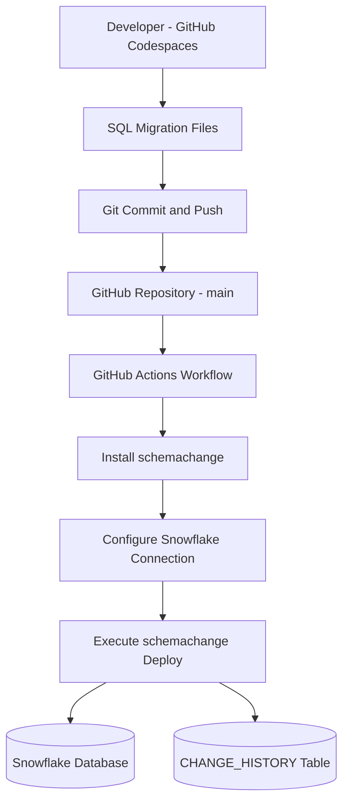

# Snowflake Schema Migration CI/CD with GitHub Actions

An automated database schema migration pipeline built with **Snowflake**, **schemachange**, **GitHub Actions**, and **GitHub Codespaces**.

This project demonstrates how SQL-based database schema changes can be version-controlled, tracked, and automatically deployed to Snowflake through a GitHub Actions workflow.

## Architecture



## Technology Stack

| Technology | Purpose |
|---|---|
| Snowflake | Cloud data platform and database |
| schemachange 4.4.0 | Version-controlled SQL migrations |
| GitHub Actions | Automated deployment workflow |
| GitHub Codespaces | Cloud development environment |
| Snowflake CLI | Database interaction and verification |
| Python 3.12 | GitHub Actions execution environment |
| Git | Version control |

## Project Structure

```text
snowflake-schemachange-cicd/
├── .github/
│   └── workflows/
│       └── deploy.yml
├── migrations/
│   ├── V1.1.1__initial_objects.sql
│   ├── V1.1.2__add_age_column.sql
│   └── V1.1.3__add_email_column.sql
├── schemachange-config.yml
└── README.md
```

## Database Schema

The project uses the following Snowflake database objects:

- Database: `SCHEMACHANGE_DEMO`
- Schema: `PUBLIC`
- Table: `HELLO_WORLD`
- Migration history: `CHANGE_HISTORY`

### Migration History

| Version | Migration | Description |
|---|---|---|
| 1.1.1 | `V1.1.1__initial_objects.sql` | Creates the HELLO_WORLD table |
| 1.1.2 | `V1.1.2__add_age_column.sql` | Adds the AGE column |
| 1.1.3 | `V1.1.3__add_email_column.sql` | Adds the EMAIL column |

### Final Table Structure

| Column | Data Type |
|---|---|
| ID | NUMBER(38,0) |
| NAME | VARCHAR(100) |
| AGE | NUMBER(38,0) |
| EMAIL | VARCHAR(255) |

## How the CI/CD Pipeline Works

### 1. Create a Migration

Database changes are written as versioned SQL migration files inside the `migrations/` directory.

For example:

```sql
ALTER TABLE SCHEMACHANGE_DEMO.PUBLIC.HELLO_WORLD
ADD COLUMN EMAIL VARCHAR(255);
```

### 2. Push Changes to GitHub

The developer commits and pushes the migration to the `main` branch.

```bash
git add migrations/
git commit -m "feat: add new database migration"
git push origin main
```

### 3. Trigger GitHub Actions

The deployment workflow is triggered when changes are pushed to the `main` branch in either:

- `migrations/**`
- `.github/workflows/deploy.yml`

The workflow can also be started manually using `workflow_dispatch`.

### 4. Configure the Environment

GitHub Actions:

1. Checks out the repository.
2. Sets up Python 3.12.
3. Installs schemachange 4.4.0.
4. Reads Snowflake credentials from GitHub Actions secrets.
5. Generates a temporary Snowflake connection configuration.
6. Executes the migration deployment.

### 5. Deploy Database Changes

schemachange connects to Snowflake and checks the migration history table.

Previously applied versioned migrations are skipped, while new migrations are executed in version order.

The migration history is recorded in:

`SCHEMACHANGE_DEMO.PUBLIC.CHANGE_HISTORY`

## GitHub Actions Secrets

The workflow requires the following repository secrets:

| Secret | Description |
|---|---|
| SNOWFLAKE_ACCOUNT | Snowflake account identifier |
| SNOWFLAKE_USER | Snowflake username |
| SNOWFLAKE_PASSWORD | Snowflake password |
| SNOWFLAKE_WAREHOUSE | Snowflake virtual warehouse |

Configure these under:

**Repository Settings → Secrets and variables → Actions → Repository secrets**

Credentials must not be committed to the repository.

## Local Deployment

With schemachange installed and a valid Snowflake connection configured, migrations can be deployed manually.

```bash
schemachange deploy \
  --config-file schemachange-config.yml \
  -f migrations
```

A dry run can be performed before deployment:

```bash
schemachange deploy \
  --config-file schemachange-config.yml \
  -f migrations \
  --dry-run
```

## Verification

Use the Snowflake CLI to inspect the resulting table:

```bash
snow sql -c default -q \
  "DESC TABLE SCHEMACHANGE_DEMO.PUBLIC.HELLO_WORLD;"
```

To inspect the migration history:

```bash
snow sql -c default -q \
  "SELECT * FROM SCHEMACHANGE_DEMO.PUBLIC.CHANGE_HISTORY;"
```

## End-to-End Test

An end-to-end deployment test was performed using migration `V1.1.3__add_email_column.sql`.

Test procedure:

1. Created a new versioned SQL migration.
2. Committed and pushed the file to GitHub.
3. Triggered the GitHub Actions deployment workflow.
4. Confirmed that the workflow completed successfully.
5. Queried Snowflake through the CLI.
6. Verified that the `EMAIL VARCHAR(255)` column existed.

**Result:** The database schema change was successfully deployed and verified.

## Key Concepts Demonstrated

- Database schema version control
- Automated database deployments
- SQL migration management
- Migration history tracking
- Idempotent execution of versioned migrations
- GitHub Actions workflow automation
- Secure credential injection through repository secrets
- Snowflake CLI-based verification
- Cloud-based development with GitHub Codespaces

## Production Considerations

This project is a demonstration environment.

For production use, additional controls should be considered:

- Replace `ACCOUNTADMIN` with a dedicated least-privilege deployment role.
- Use key-pair authentication or workload identity federation instead of password-based authentication where supported.
- Add pull-request validation before merging migrations.
- Separate development, staging, and production environments.
- Introduce deployment approvals for production.
- Define backup, recovery, and migration failure procedures.

## Conclusion

This project demonstrates a working automated database schema deployment pipeline using Snowflake, schemachange, and GitHub Actions.

By storing SQL migrations in Git and executing them through CI/CD, database changes become version-controlled, traceable, and repeatable.

The end-to-end deployment was validated by automatically adding a new column to an existing Snowflake table.
